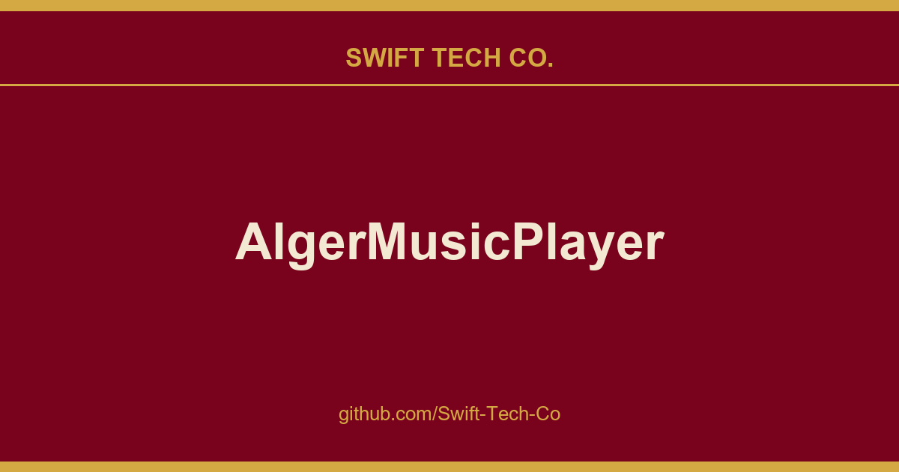

# AlgerMusicPlayer

## What This Is

A practical reference entry for product and engineering: the AlgerMusicPlayer notes, examples and fixes we reach for repeatedly. Kept current as part of the wider Swift Tech Co. engineering library.

## Images

[](https://github.com/Swift-Tech-Co/AlgerMusicPlayer)

## 项目简介

一个第三方音乐播放器、本地服务、桌面歌词、音乐下载、最高音质

## 预览地址

https://github.com/Swift-Tech-Co/AlgerMusicPlayer

## 软件截图

[](https://github.com/Swift-Tech-Co/AlgerMusicPlayer)
[](https://github.com/Swift-Tech-Co/AlgerMusicPlayer)
[](https://github.com/Swift-Tech-Co/AlgerMusicPlayer)
[](https://github.com/Swift-Tech-Co/AlgerMusicPlayer)
[](https://github.com/Swift-Tech-Co/AlgerMusicPlayer)
[](https://github.com/Swift-Tech-Co/AlgerMusicPlayer)

## 项目启动

```bash
npm install
npm run dev
```

## 开发文档

点击这里[开发文档](./DEV.md)

## 赞赏☕️

赞赏列表
| 微信赞赏 | 支付宝赞赏 |
| :--------------------------------------------------------------------------------: | :--------------------------------------------------------------------------------: |
|  <br><small>喝点咖啡继续干</small> |  <br><small>来包辣条吧~</small> |

## 项目统计

[](https://github.com/Swift-Tech-Co/AlgerMusicPlayer)
[](https://github.com/Swift-Tech-Co/AlgerMusicPlayer)

## 欢迎提Issues

## 声明

本软件仅用于学习交流，禁止用于商业用途，否则后果自负。
希望大家还是要多多支持官方正版，此软件仅用作开发教学。

---

## Swift Tech Co.

Built and maintained by Swift Tech Co.

AI Automation | FinTech Platforms | Custom Software and Mobile Apps | SaaS Platforms | Cloud Infrastructure | Cybersecurity | SEO and Marketing | API Integration

**Join our community on Telegram:** [t.me/+Qt_eFvkb2rliMzNh](https://t.me/+Qt_eFvkb2rliMzNh)

Home | Services | Careers | Referral Program | Influencers | About | Contact

**Connect**

- Website: https://github.com/Swift-Tech-Co/AlgerMusicPlayer
- LinkedIn: [linkedin.com/in/stephenoladoke](https://www.linkedin.com/in/stephenoladoke/)
- LinkedIn (Company): [linkedin.com/company/swift-tech-co](https://www.linkedin.com/company/swift-tech-co)
- X: [@MrOladoke](https://x.com/MrOladoke)
- Instagram: [@mr.oladoke](https://www.instagram.com/mr.oladoke/)
- Organization: [github.com/Swift-Tech-Co](https://github.com/Swift-Tech-Co)

## Sources

Compiled and maintained from upstream [algerkong/AlgerMusicPlayer](https://github.com/algerkong/AlgerMusicPlayer) under permissive open-source license.

---

Maintained by [Swift Tech Co.](https://github.com/Swift-Tech-Co) - [Telegram](https://t.me/+Qt_eFvkb2rliMzNh)

## Sources

Compiled and maintained from upstream [algerkong/AlgerMusicPlayer](https://github.com/algerkong/AlgerMusicPlayer) under permissive open-source license.

---

Maintained by [Swift Tech Co.](https://github.com/Swift-Tech-Co) - [Telegram](https://t.me/+Qt_eFvkb2rliMzNh)

## Sources

Compiled and maintained from upstream [algerkong/AlgerMusicPlayer](https://github.com/algerkong/AlgerMusicPlayer) under permissive open-source license.

---

Maintained by [Swift Tech Co.](https://github.com/Swift-Tech-Co) - [Telegram](https://t.me/+Qt_eFvkb2rliMzNh)

## Sources

Compiled and maintained from upstream [algerkong/AlgerMusicPlayer](https://github.com/algerkong/AlgerMusicPlayer) under permissive open-source license.

---

Maintained by [Swift Tech Co.](https://github.com/Swift-Tech-Co) - [Telegram](https://t.me/+Qt_eFvkb2rliMzNh)

## Sources

Compiled and maintained from upstream [algerkong/AlgerMusicPlayer](https://github.com/algerkong/AlgerMusicPlayer) under permissive open-source license.

---

Maintained by [Swift Tech Co.](https://github.com/Swift-Tech-Co) - [Telegram](https://t.me/+Qt_eFvkb2rliMzNh)